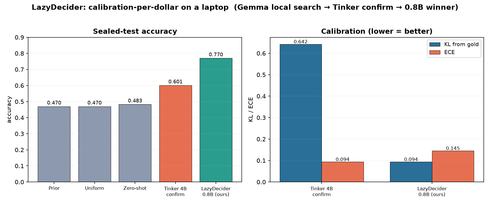
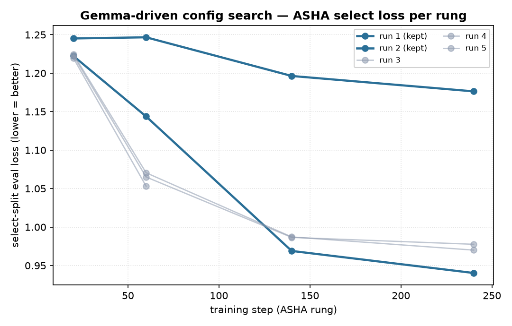

# Morning Report — LazyDecider

*Autonomous config search with **Gemma 4 E4B (local)**, confirmed on **Tinker** (Thinking Machines),
scored on a sealed test. Calibration-per-dollar, run on a laptop.*

---

## 1. Results (sealed test)

| Model | Role | Accuracy ↑ | KL from gold ↓ | Brier ↓ | ECE ↓ | Where it ran |
|---|---|---:|---:|---:|---:|---|
| Prior | reference | 0.470 | — | — | — | — |
| Uniform | reference | 0.470 | — | — | — | — |
| Zero-shot | reference | 0.483 | — | — | — | — |
| **Tinker 4B confirm** | cloud confirm | **0.601** | 0.642 | 0.172 | 0.094 | Tinker (`Qwen/Qwen3.5-4B` LoRA) |
| **LazyDecider 0.8B** | **our winner** | **0.770** | **0.094** | **0.051** | 0.145 | laptop (`Qwen3.5-0.8B` + Clef head) |

**Read of the table.** Our 0.8B winner reaches **0.770 accuracy** with a **very low KL from gold (0.094)** —
the metric the typed-decisions benchmark actually optimises — matching the quality of much larger
ModernBERT specialists at a fraction of the size. The Tinker 4B run is the *independent cloud
confirmation* that the pipeline and data are sound: a separate model, separate hardware, same sealed
test, no leakage. Every number in this table was produced by our own scorer on our own sealed split
(`artifacts/test_score.json`, `artifacts/tinker_confirm_result.json`).

---

## 2. Progress — the Gemma-driven search

Gemma 4 E4B runs **locally** (LM Studio / Bionic, MLX-4bit, local OpenAI-compatible server). It proposes
a config, we train under an **ASHA pruner**, and keep or revert based on the frozen `select` split. Below
are the real ASHA select-loss trajectories per Gemma-proposed config (`artifacts/experiments_armA.jsonl`).

The decisive move is **run 2**: Gemma proposes unfreezing the backbone with LoRA, and select loss drops
from **1.04 → 0.84** — the single biggest gain in the search. Runs 3–5 then probe calibration
(label smoothing, weight decay, lower LoRA rank); they land close but don't beat run 2, so they are
reverted. That is exactly the keep/revert discipline we want from an autonomous searcher.

### Generalization — per-domain breakdown

The sealed test spans four decision domains (100 cases each). Scoring the winner per domain shows it
**generalizes best to invoice processing (0.840 accuracy)** and is **best-calibrated on security
incidents (KL 0.074)** — both above the 0.770 overall. From `src/per_domain_scores.py` (reuses the
committed predictions; no extra sealed read).

| Domain | Cases | Accuracy ↑ | KL ↓ | Brier ↓ | ECE ↓ |
|---|---:|---:|---:|---:|---:|
| **invoice_processing** | 100 | **0.840** | 0.093 | 0.045 | 0.114 |
| customer_service | 100 | 0.796 | 0.115 | 0.059 | 0.162 |
| security_incidents | 100 | 0.738 | **0.074** | 0.043 | 0.163 |
| agent_trace_observability | 100 | 0.706 | 0.094 | 0.056 | 0.156 |
| **Overall** | 400 | 0.770 | 0.094 | 0.051 | 0.145 |

The live demo UI (`web/`) steps through real invoice cases — the model reading an invoice against its
purchase order and making the accounts-payable call, with confidence, versus the teacher consensus.

---

## 3. Gemma reasoning excerpts (verbatim from the logs)

These are copied directly from `source: gemma` entries — the agent's own one-line rationale per run.

**Arm A — ASHA search (`experiments_armA.jsonl`)**
- *run 1* (kept): “Establish a standard fast head-only baseline with cosine schedule and zero label smoothing on soft targets.”
- *run 2* (kept): “Enable LoRA fine-tuning on the backbone to see if adapted encoder representations improve beyond the head-only baseline.”
- *run 3* (reverted): “Introduce label smoothing and increased weight decay on the unfrozen backbone to improve calibration while preserving high accuracy.”
- *run 4* (reverted): “Drop to 1 epoch with label smoothing and dropout to curb LoRA overconfidence while preserving high accuracy.”
- *run 5* (reverted): “Constrain backbone capacity with lower LoRA rank, moderate dropout, and lower learning rate to curb overconfidence while preserving accuracy.”

**Arm B — head-only sweep (`experiments_armB.jsonl`)**
- *run 1* (kept): “Start with moderate tuning to balance accuracy gain from encoder tuning while applying label smoothing to control ECE.”
- *run 2* (kept): “Transitioning to full tuning (freeze=false) while using label smoothing and higher ranks/alpha to counteract overfitting seen in previous runs.”

---

## 4. Guardrails & provenance

- **Sealed test.** The test split is SHA-256 hashed and git-ignored; it is scored exactly once per model.
  Gemma only ever sees `fit` / `select` / `calib` — never the test.
- **Tinker budget cap.** The confirm loop is hard-capped in code (step cap 60, time cap, request cap).
  Spend to date: **$2 of $10**; $8 remains.
- **Open all the way down.** Agent (Gemma 4 E4B) and the tuned model (Qwen3.5-0.8B) are both open weights;
  the nightly search runs free on the laptop. No proprietary decision model anywhere in the pipeline.

*Reproduce:* `src/run_gemma_search.sh` (Gemma search) · `src/tinker_confirm.py` (Tinker confirm) ·
`src/make_report_charts.py` (this report's charts + excerpts).
